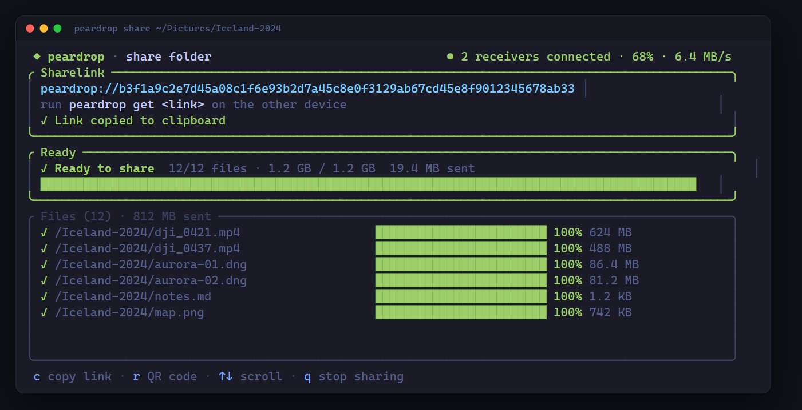

<p align="center">
  
</p>

<h1 align="center">peardrop CLI</h1>

<p align="center">
  <strong>Send files and folders between devices from the terminal.</strong><br>
  Peer-to-peer, with no server in between: one sharelink, or a QR code.
</p>

<p align="center">
  <a href="https://github.com/peardrive/peardrop-cli/releases"></a>
  <a href="https://github.com/peardrive/peardrop-cli/actions/workflows/ci.yml"></a>
  
  
  <a href="https://github.com/peardrive/peardrop-cli/releases"></a>
</p>

## Install

Requires **Node.js 26.4 or newer**.

```bash
npm install -g https://github.com/peardrive/peardrop-cli/releases/latest/download/peardrop-cli.tgz
peardrop --help
```

Every release also keeps a pinned copy as `peardrop-cli-<version>.tgz` on the
[Releases](https://github.com/peardrive/peardrop-cli/releases) page.

## Share a file or folder

```bash
peardrop share ./photos        # a folder
peardrop share ~/report.pdf    # a single file
```

`share` copies everything into the share before handing out a link, so the link only exists once
that copy has finished: make sure there is room for a second copy of the data, and note that edits
made to the originals afterwards are not picked up.

When the link is ready it is printed, can be shown as a QR code, and is copied to your clipboard —
paste it on the other device, or scan it. `peardrop` keeps seeding the share until you stop it, so
leave it running while the other side downloads.

| Key | Action |
| --- | --- |
| `c` | copy the sharelink again |
| `r` | show or hide the QR code |
| `q` | stop sharing |

`--no-copy` turns off the automatic clipboard copy.

## Download a share

```bash
peardrop get peardrop://…                  # into ./<share-name>
peardrop get peardrop://… -o ~/Downloads   # into ~/Downloads/<share-name>
```

`get` looks up the sender, reads the file list, and writes the files straight to disk one at a time,
with progress and speed. A folder share keeps its tree; a single file lands directly in the output
folder:

```
photos/                # peardrop share ./photos   →   get → ./photos/…
  nested/a.jpg
  notes.txt
```

Nothing is ever overwritten: if `notes.txt` already exists, the download becomes `notes (1).txt`.
Press `q` to cancel — files already written are kept, and the one in progress is removed.

## Automation (`--json`)

Add `--json` to either command to get one JSON event per line instead of the TUI:

```bash
peardrop share ./photos --json
# {"event":"sharelink","link":"peardrop://…","driveId":"drive_…"}
# {"event":"ready","files":9,"bytes":4230000}

peardrop get peardrop://… -o ./out --json
# {"event":"progress","percent":42,"bytes":1770000,"total":4230000,"filesDone":3,"files":9}
# {"event":"done","files":9,"total":9,"path":"…/out/photos","partial":false,"failed":0}
```

Exit codes: `0` success · `1` failure or a partial download · `2` bad usage. `share` keeps running
until it receives `SIGINT` or `SIGTERM`.

## Where things go

Nothing is written outside the output folder. Session data lives in `~/.peardrop/sessions/`, and
anything printed while the TUI is open goes to `~/.peardrop/peardrop.log`. Set `PEARDROP_HOME` to
move both.

## Development

```bash
npm install            # installs the native modules and builds dist/
npm link               # puts `peardrop` on your PATH
npm test               # unit tests + an in-process DHT roundtrip
npm run e2e            # two real CLI processes, byte-for-byte comparison
npm run dev:bootstrap  # private DHT for local testing (use --bootstrap host:port)
```

Branches, releases and versioning are in [CONTRIBUTING.md](CONTRIBUTING.md) and
[RELEASING.md](RELEASING.md); what changed in each version is in [CHANGELOG.md](CHANGELOG.md).
